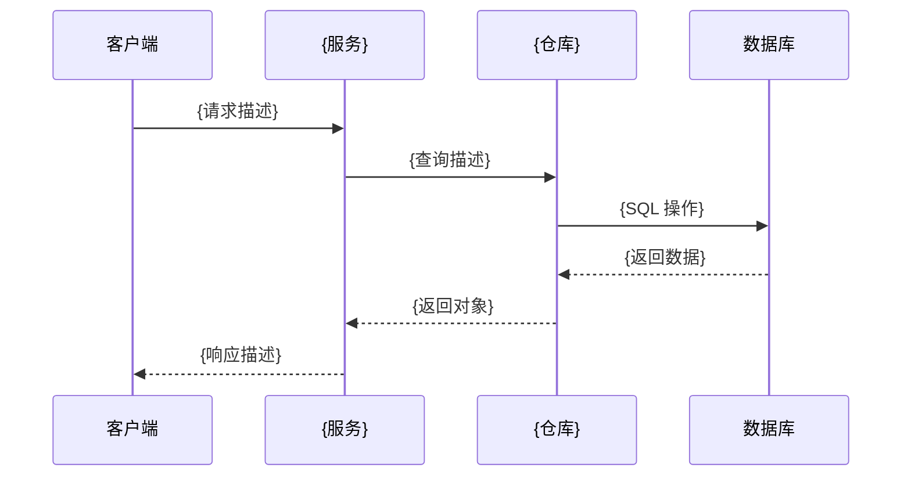

<a id="top"></a>

## 参考

本章提供三个快速参考表，供在编写需求、设计和测试策略时快速查阅。

<a id="section-12-1"></a>

### EARS 模式快速参考表

EARS（Easy Approach to Requirements Syntax）的 6 种模式速查：

| 模式名称 | 语法模板 | 简短示例 |
|---------|---------|---------|
| **Ubiquitous**（普遍性） | `THE <系统> SHALL <响应>` | `THE 系统 SHALL 使用 AES-256 加密所有静态数据` |
| **Event-driven**（事件驱动） | `WHEN <触发事件> THEN <系统> SHALL <响应>` | `WHEN 用户提交有效凭证 THEN 系统 SHALL 返回 JWT 令牌` |
| **State-driven**（状态驱动） | `WHILE <状态> THE <系统> SHALL <响应>` | `WHILE 会话处于活动状态 THE 系统 SHALL 每 15 分钟刷新一次令牌` |
| **Unwanted event**（非预期事件） | `IF <非预期条件> THEN <系统> SHALL <响应>` | `IF 登录失败 3 次 THEN 系统 SHALL 锁定账户 15 分钟` |
| **Optional feature**（可选功能） | `WHERE <包含某功能> THE <系统> SHALL <响应>` | `WHERE 已启用邮件通知 THE 系统 SHALL 针对严重错误发送告警` |
| **Complex**（复合） | `WHEN <触发事件> WHILE <状态> THE <系统> SHALL <响应>` | `WHEN 用户编辑记录 WHILE 记录被锁定 THEN 系统 SHALL 拒绝修改` |

**选择指南**：

| 场景描述 | 推荐模式 |
|---------|---------|
| 无条件、始终成立的行为 | Ubiquitous |
| 由用户操作或系统事件触发 | Event-driven |
| 在特定状态下持续发生 | State-driven |
| 错误处理、异常响应 | Unwanted event |
| 仅在特定功能启用时生效 | Optional feature |
| 需要多个前提条件 | Complex |

---

<a id="section-12-2"></a>

### INCOSE 质量规则快速参考表

INCOSE 需求质量规则速查（包含可实现性与实现无关性）：

| 规则名称 | 说明 | 违规示例 |
|---------|------|---------|
| **Necessary**（必要性） | 每条需求必须有明确的业务价值或技术必要性，不应包含不必要的需求 | `THE 系统 SHALL 为所有按钮使用蓝色配色`（任意设计决策，无业务必要性） |
| **Achievable**（可实现性） | 需求在技术和资源约束下必须是可实现的，不应提出不切实际的要求 | `THE 系统 SHALL 在 0 毫秒内响应所有请求`（物理上不可能实现） |
| **Unambiguous**（明确性） | 需求必须只有一种解释方式，避免模糊词语（如“快速”、“高效”） | `THE 系统 SHALL 快速处理请求`（“快速”无明确标准） |
| **Complete**（完整性） | 需求必须包含所有必要信息，不应遗漏关键细节或留有 TBD | `WHEN 用户上传文件 THEN 系统 SHALL 验证文件`（未说明验证什么） |
| **Singular**（单一性） | 每条需求只表达一个单一的条件或行为，不应用“和/或”连接多个需求 | `WHEN 登录成功 THEN 系统 SHALL 创建会话、记录事件并发送邮件`（包含三个行为） |
| **Verifiable**（可验证性） | 需求必须可以通过测试、检查或演示来验证，避免“最大化”、“最小化”等无法测试的词语 | `THE 系统 SHALL 最大化系统可用时间`（无明确成功标准） |
| **Traceable**（可追溯性） | 需求必须能追溯到来源（业务目标、用户需求、法规），并能链接到设计和测试 | `系统必须加密数据`（无编号、无来源引用） |
| **Feasible**（可行性） | 需求在项目的时间、成本和技术约束下必须是可行的 | `THE 系统 SHALL 在上线首日支持 100 亿个并发用户`（超出合理资源范围） |
| **Consistent**（一致性） | 需求之间应能同时满足，不相互矛盾 | `THE 系统 SHALL 离线运行` 与 `THE 系统 SHALL 始终访问在线服务`（约束冲突） |
| **Implementation-free**（实现无关性） | 需求描述做什么，设计决定怎么做 | `THE 系统 SHALL 使用 PostgreSQL 存储数据`（限制实现选择） |

---

<a id="section-12-3"></a>

### 正确性模式快速参考表

属性测试（Property-Based Testing）的 7 种正确性模式速查：

| 模式名称 | 描述 | 适用场景 |
|---------|------|---------|
| **Invariants**（不变量） | 无论输入如何变化，某些属性始终保持不变 | 数据结构的大小约束、业务规则的持续满足（如账户余额不为负） |
| **Round Trip**（往返） | 将操作与其逆操作组合后，结果应回到原始状态（`parse(print(x)) == x`） | 解析器/序列化器（JSON、XML、CSV）、编码/解码、压缩/解压 |
| **Idempotence**（幂等性） | 执行操作两次与执行一次的结果相同（`f(f(x)) == f(x)`） | HTTP PUT/DELETE 请求、数据库 upsert、格式化操作、幂等 API |
| **Metamorphic**（变形） | 以已知方式改变输入后，输出应以可预测的方式变化（无需知道确切输出） | 排序算法（添加元素后结果仍有序）、搜索（更宽松的查询返回更多结果） |
| **Model-Based**（基于模型） | 将优化实现与简单的参考实现进行比较，两者结果应一致 | 性能优化代码（与朴素实现对比）、缓存层（与直接查询对比） |
| **Confluence**（汇合） | 操作的执行顺序不影响最终结果（操作可交换） | 并发操作、事件处理顺序、数据库事务、分布式系统的最终一致性 |
| **Error Conditions**（错误条件） | 无效输入应正确触发错误，而不是静默失败或产生错误结果 | 输入验证、边界值处理、空值/null 处理、类型检查 |

**快速决策指南**：

| 问题 | 如果是 → 考虑的模式 |
|------|-------------------|
| 是否有解析器或序列化器？ | **Round Trip**（必须使用） |
| 操作是否应该幂等？ | **Idempotence** |
| 是否有简单的参考实现可以对比？ | **Model-Based** |
| 是否有始终成立的业务规则？ | **Invariants** |
| 输入变化是否导致可预测的输出变化？ | **Metamorphic** |
| 操作顺序是否不应影响结果？ | **Confluence** |
| 是否需要验证错误处理逻辑？ | **Error Conditions** |

<a id="document-language"></a>

### 文档语言策略

语言优先级：用户明确指定 → 已有 Spec 语言 → 新建 Spec 时当前对话主要语言。验收标准保留 WHEN、THEN、WHILE、IF、WHERE、THE、SHALL，其余自然语言使用 Spec 文档语言。文件名、API、字段名、枚举值等技术标识符保持原样；不能因结构词为英文就将整句写成英文。默认模板为中文，其他语言须先翻译模板自然语言再初始化。

<a id="template-requirements"></a>

### requirements.md 完整模板

<!-- template:requirements.md:start -->
``````markdown
# 需求文档：{{featureName}}

## 简介

{简要描述该功能的目的、背景和价值。1-2 段文字即可。}

## 术语表

{定义本文档中使用的关键术语和概念，确保所有人对术语有共同理解。}

- **术语1**（英文术语）: 定义说明
- **术语2**（英文术语）: 定义说明
- **术语3**（英文术语）: 定义说明

## 需求

### 需求 1: {需求名称}

**用户故事**: {使用"作为...我希望...以便..."格式描述业务价值}

#### 验收标准

1. WHEN {触发事件} THEN {系统} SHALL {系统响应}
2. {使用 EARS 模式编写的验收标准 2}
3. {使用 EARS 模式编写的验收标准 3}

### 需求 2: {需求名称}

**用户故事**: {用户故事}

#### 验收标准

1. {验收标准 1}
2. {验收标准 2}
3. {验收标准 3}

{继续添加更多需求...}
``````
<!-- template:requirements.md:end -->

<a id="template-design"></a>

### design.md 完整模板

<!-- template:design.md:start -->
``````markdown
# 设计文档：{{featureName}}

## 概述

{简要描述设计目标、核心决策和设计原则。1-3 段文字。}

### 核心目标

1. **{目标1}**：{说明}
2. **{目标2}**：{说明}
3. **{目标3}**：{说明}

### 设计原则

- **{原则1}**：{说明}
- **{原则2}**：{说明}

## 架构

### 系统组件

{描述主要组件及其职责。}

1. **{组件1}**：{职责说明}
2. **{组件2}**：{职责说明}
3. **{组件3}**：{职责说明}

### 架构图

```mermaid
graph TD
    A[{组件A}] --> B[{组件B}]
    B --> C[{组件C}]
    C --> D[({数据存储})]
```

### 数据流

{描述数据在系统中的流向。}

## 组件和接口

### 1. {组件名称}

**职责**：{组件的主要职责}

**接口**：
```typescript
interface {ComponentName} {
  {methodName}({param}: {Type}): Promise<{ReturnType}>;
}
```

**依赖**：{依赖的其他组件}

### 2. {组件名称}

**职责**：{组件的主要职责}

**接口**：
```typescript
interface {ComponentName} {
  {methodName}({param}: {Type}): Promise<{ReturnType}>;
}
```

**依赖**：{依赖的其他组件}

## 数据模型

### {实体名称}

```typescript
interface {EntityName} {
  id: string;           // UUID v4，主键
  {field1}: {Type};     // {字段说明}
  {field2}: {Type};     // {字段说明}
  createdAt: Date;      // 创建时间
  updatedAt: Date;      // 最后更新时间
}
```

### 实体关系图

```mermaid
erDiagram
    {Entity1} {
        string id PK
        string {field1}
        datetime createdAt
    }
    {Entity2} {
        string id PK
        string {entity1Id} FK
        string {field1}
    }
    {Entity1} ||--o{ {Entity2} : "{关系描述}"
```

## 序列图

### {流程名称}



## 错误处理

### 错误类型

| 错误场景 | HTTP 状态码 | 错误码 | 处理方式 |
|---------|-----------|--------|---------|
| {错误场景1} | {状态码} | {错误码} | {处理方式} |
| {错误场景2} | {状态码} | {错误码} | {处理方式} |

### 错误响应格式

```json
{
  "error": {
    "code": "{ERROR_CODE}",
    "message": "{错误消息}",
    "requestId": "{请求ID}"
  }
}
```

## 测试策略

### 测试方法

1. **单元测试**：{说明测试范围}
2. **集成测试**：{说明测试范围}
3. **属性测试**：{说明测试范围，如适用}

### 正确性属性

1. **{属性名称}**（{属性类型：Invariant/Round Trip/Idempotence 等}）
   - 属性：{描述系统应满足的不变量}
   - 测试方法：{如何验证此属性}

2. **{属性名称}**（{属性类型}）
   - 属性：{描述}
   - 测试方法：{如何验证}

### 覆盖率目标

- 单元测试覆盖率：≥ {目标百分比}%
- 集成测试：覆盖所有主要用户流程
- 属性测试：覆盖所有正确性属性

## 实现考虑

### 技术选择

**{技术/库名称}**：
- 理由：{选择理由}
- 替代方案：{其他选项}

### 性能考虑

- **{性能优化点1}**：{说明}
- **{性能优化点2}**：{说明}

### 安全考虑

- **{安全措施1}**：{说明}
- **{安全措施2}**：{说明}

### 可维护性

- **{可维护性措施1}**：{说明}
- **{可维护性措施2}**：{说明}

### 兼容性

- **环境要求**：{说明}
- **向后兼容性**：{说明}
``````
<!-- template:design.md:end -->

<a id="template-tasks"></a>

### tasks.md 完整模板

<!-- template:tasks.md:start -->
``````markdown
# 实现计划：{{featureName}}

## 概述

{简要描述实现计划的范围和目标。说明主要的实现阶段和预期产出。}

## 任务

- [ ] 1. {第一个功能模块}
  - [ ] 1.1 {第一个子任务}
    - {实现细节1}
    - {实现细节2}
    - _需求: X.X_

  - [ ] 1.2 {第二个子任务}
    - {实现细节1}
    - _需求: X.X, X.X_

- [ ] 2. {第二个功能模块}
  - [ ] 2.1 {子任务}
    - {实现细节}
    - _需求: X.X_

  - [ ]* 2.2 {可选子任务}
    - {实现细节}
    - _需求: X.X_

- [ ] 3. Checkpoint - {验证目标}

- [ ] 4. {第三个功能模块}
  - [ ] 4.1 {子任务}
    - {实现细节}
    - _需求: X.X_

- [ ] 5. Checkpoint - {最终验证目标}

## 注释

- 任务标记 `*` 的为可选任务，可以跳过以加快 MVP 交付
- 每个任务都引用了具体的需求编号以确保可追溯性
- Checkpoint 任务确保增量验证和用户反馈

## Task Dependency Graph

```json
{
  "waves": [
    { "id": 0, "tasks": ["1.1"] },
    { "id": 1, "tasks": ["1.2", "2.1"] },
    { "id": 2, "tasks": ["2.2"] },
    { "id": 3, "tasks": ["3"] }
  ]
}
```
``````
<!-- template:tasks.md:end -->

<a id="template-bugfix"></a>

### bugfix.md 完整模板

<!-- template:bugfix.md:start -->
``````markdown
# Bug 分析：{{featureName}}

## Bug 信息

- **Bug ID**：{issue 编号}
- **严重程度**：{Critical / High / Medium / Low}
- **影响版本**：{版本号}
- **报告日期**：{YYYY-MM-DD}
- **环境**：{操作系统、浏览器、运行环境等}

## Bug Condition 分析

### 当前行为（Current Behavior）

**触发条件**：
{描述触发 bug 的具体操作或输入}

**复现步骤**：
1. {步骤 1}
2. {步骤 2}
3. {步骤 3}
4. 观察到：{错误表现}

**错误表现**：
{详细描述系统的错误行为，包括错误消息、错误结果或异常状态}

**错误日志**（如有）：
```
{粘贴相关的错误日志或堆栈跟踪}
```

### 预期行为（Expected Behavior）

**正确结果**：
{描述在相同触发条件下，系统应该做什么}

**验证标准**：
1. {验证标准 1：如何判断修复是否成功}
2. {验证标准 2}
3. {验证标准 3}

### 不变行为（Invariant Behavior）

修复过程中，以下行为必须保持不变：

1. {不变行为 1：描述必须继续正常工作的功能}
2. {不变行为 2}
3. {不变行为 3}
4. {性能指标：如响应时间不应超过 Xms}

## 根因分析

**根本原因**：
{分析 bug 的根本原因，说明为什么会出现当前行为}

**相关代码位置**：
- `{文件路径}:{行号}` - {说明}

## 修复范围

**在范围内**：
- {需要修改的内容 1}
- {需要修改的内容 2}

**不在范围内**（不应在此次修复中改动）：
- {不应改动的内容 1}
- {不应改动的内容 2}
``````
<!-- template:bugfix.md:end -->
